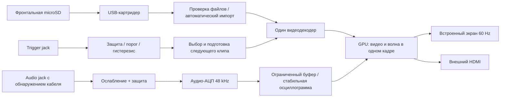

# Архитектура v2: видео 60 FPS и осциллограмма без мерцания

## Требования владельца

- Проигрывать видео в 60 FPS и рисовать поверх плавную осциллограмму.
- Каждый входной триггер выбирает случайный клип и запускает его с начала.
- Звук из видео не нужен; осциллограмма включается при подключённом аудиокабеле.
- Видео копируются обычными файлами на фронтальную microSD; подготовка на Mac
  через терминал не требуется.
- Внешний выход HDMI, USB-зарядка. USB-A допустим и выбран для простоты.
- Компактная и простая конструкция, закупки преимущественно РФ/Ozon.
- Владелец начинающий в пайке: нужны готовые узлы и пошаговая инструкция.
- Старые решения использовать только там, где они подходят новым требованиям.

v1 работала на Zero 2 W с небольшим SPI TFT, но эта архитектура не принимается
за гарантированную основу 60 FPS. [Разбор v1](v1-reconstruction.md) отделяет
подтверждённые факты от отсутствующих частей резервной копии.

## Два компактных пути сборки

У владельца есть только лабораторный БП 12 V / 2 A. Любой компьютер, экран,
карты и разъёмы закупаются заново. Основа обоих вариантов — Zero 2 W и TFT
2.8″ уровня v1, с проверкой реальных 60 FPS. Спецификация «1080p30» не
означает универсальный предел 30 FPS при низком разрешении.

1. Пайка входных каскадов: отдельный I²S-АЦП PCM1808, тактовый генератор,
   обвязка и защищённый триггер на PC817C.
2. Меньше пайки: маленькие внутренние платы PCM1808 и PC817. Это узлы внутри
   Eurorack-модуля; внешний настольный аудиоинтерфейс не используется.

Для стенда используется имеющийся источник 12 V; в кейсе — стандартный
разъём Eurorack +12 V/GND. Внутренние преобразователи делают 5 V для Pi/экрана
и отдельной USB-A-зарядной ветви. Основной компьютер, дисплей и карты одинаковы
в двух списках. Дорогой HDMI-дисплей и другая основная плата не являются
обязательными покупками. [Актуальная закупка](shopping-links.md).

### Экран: критическая проверка для дешёвого пути

320×240 RGB565 при 60 FPS требует минимум
`320 × 240 × 16 × 60 = 73.728 Mbit/s` полезного потока без накладных расходов.
Драйвер, контроллер и копирование добавляют ограничения. Более мощный CPU
не увеличит полосу того же интерфейса. На карточке TFT v1 написано ST7789,
следы сборки используют ILI9341; реальный контроллер и частоту надо установить.
Внутренняя развёртка LCD 60 Hz не доказывает 60 новых кадров, принятых по SPI.

Если старый SPI-экран не выполняет требование, следующий дешёвый кандидат —
панель с доступными RGB/DPI-сигналами и подтверждёнными 60 Hz. Это не требует
покупки дорогого HDMI-контроллера. Но RGB-поддержка внутри чипа не означает,
что эти сигналы выведены на данной SPI-плате; также нужно согласовать GPIO
дисплея с аудиовходом и CV. Конкретная замена и её цена пока неизвестны.

## Видеопуть и осциллограмма

Программа должна использовать аппаратное декодирование для поддерживаемого
H.264, масштабирование и композицию на GPU. Выбор конкретного поддерживаемого
Linux-видеостека и проверка пути декодера выполняются на целевой ОС; имя платы
само по себе не включает аппаратное ускорение.

Видео и осциллограмма рисуются в один готовый кадр. Двойная/тройная буферизация
и показ по вертикальной синхронизации предотвращают частично нарисованное
изображение и разрывы. Два независимых писателя в `/dev/fb1` исключены из схемы.
Съёмка аудио, чтение карты и импорт идут отдельно от потока вывода кадров.

Аудио захватывается в ограниченный кольцевой буфер. Рендер получает целостный
снимок; для каждой колонки вычисляются минимум и максимум, чтобы сохранить
узкие пики. Привязка к пересечению уровня с гистерезисом стабилизирует
периодическую волну. Отсутствие кабеля определяется контактом jack, а не
амплитудой: тишина при подключённом кабеле остаётся отдельным состоянием.

Для обоих вариантов — внутренний I²S-аудио-АЦП. PCM1808 и его компактная
плата требуют проверки MCLK, режима master/slave, цифровых уровней 3.3 V,
аналогового питания и Linux-драйвера. Для голой микросхемы дополнительно
нужно подтвердить корпус, переходник и полную обвязку. Отдельный Arduino
для осциллограммы не требуется.

Eurorack-аудио ослабляется и защищается перед входом АЦП. GPIO также не
принимает Eurorack-триггер напрямую. Переключающий контакт обычного jack
не считать изолированным детектором штекера и не соединять с GPIO без
рассчитанной схемы защиты.

### Переключение клипов

Не запускать новый процесс FFmpeg на каждый триггер. Список клипов и случайный
следующий выбор подготавливаются заранее, первый кадр следующего клипа —
до переключения. Пока он не готов, сохраняется предыдущий кадр вместо чёрного
провала. Задержка до нового кадра и поведение при быстрых повторных триггерах
измеряются отдельно; текущий проект не обещает неизмеренный предел задержки.

## Карта и форматы

ОС и служебный кэш находятся отдельно от фронтальной карты контента.
Zero использует внутреннюю microSD для ОС; фронтальная карта подключается отдельно.
Фронтальная карта читается без переписывания оригиналов. Вставка запускает
сканирование, пригодные клипы попадают в плейлист; извлечение останавливает
чтение и показывает сохранённый кадр/состояние отсутствия карты.

Для Zero требуется проверенный профиль низкого разрешения. Импортёр пока
оценивает формат-кандидат и не проверяет пригодность конкретной плате.
Поддержка конкретных профилей, битрейта, временных
меток, rotation metadata и аппаратного пути ещё проверяется на плате.
Прочие поддерживаемые импортёром форматы автоматически готовятся в кэш
на устройстве, с индикацией ожидания. Импорт не блокирует рендер и не должен
нагревом/нагрузкой приводить к пропуску кадров. На первом прототипе допустимо
приостанавливать импорт во время воспроизведения.

RAW не является форматом, который должен вручную создавать пользователь.
В v1 уже обнаружен MP4/AV1: расширение файла не определяет совместимость.
HDR, Dolby Vision и нетипичные кодеки требуют отдельной поддержки и не
объявляются работающими на основании обычной конвертации в yuv420p.

**60 разных кадров требуют соответствующего источника.** При воспроизведении
25/30 FPS на экране 60 Hz повторяются кадры; это не 60 уникальных кадров.
Импорт сохраняет исходную частоту до 60, не выдаёт дублирование за повышение
плавности. Интерполяция движения — отдельная потенциальная функция с ценой
по времени и артефактами, не обязательство выполнять её в реальном времени.

## Питание и сборка

Имеющийся БП даёт 12 V / 2 A (24 W до потерь преобразования). Новый внешний
БП в закупку не входит. Внутри используется преобразование +12→+5 V;
потребление Pi, экрана, АЦП и USB-зарядки проверяется совместно. Для выбранных
маленьких плат MP1584EN и USB DC/DC проверяются нагрев, пиковый ток, пульсации,
защита от переполюсовки и зарядное согласование. Маркировка «до 3 A» из v1
не является замером рабочего режима. Зарядка планируется 5 V / 1 A.

Полностью собственный регулятор из голой микросхемы требует отдельной
рассчитанной силовой схемы и разводки; его BOM пока не утверждён.
Отрицательная шина Eurorack в этой архитектуре не обязательна.

Размеры задаются всей платой, дисплеем и кабелями. Под «подходит к кейсу»
понимается проверка реального HP и глубины конкретного кейса, не гарантия
совместимости с каждым существующим корпусом. [Сборка для начинающего](assembly-plan.md).

## Состояние реализации

Получены и разобраны v1, написаны новые программные компоненты импорта
медиа и обработки осциллограммы, подготовлены проверки облачных инструментов.
Полный GPU-проигрыватель, обработчик реального CV, подключение реального АЦП,
автомонтирование/обнаружение карты и образ ОС ещё не реализованы и не проверены.
Готового аппаратного прототипа в облачной среде нет.

[Проверки 60 FPS и отсутствия мерцания](validation-60fps.md) обязательны
перед заявлением о готовности. Смета нового варианта — [BOM](bom.md).
