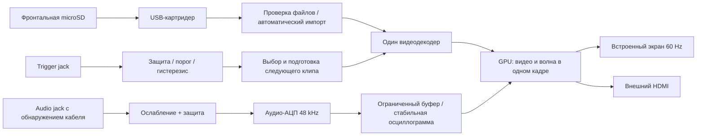

# Архитектура v2: видео 60 FPS и осциллограмма без мерцания

## Требования владельца

- Проигрывать видео в 60 FPS и рисовать поверх плавную осциллограмму.
- Каждый входной триггер выбирает случайный клип и запускает его с начала.
- Звук из видео не нужен; осциллограмма включается при подключённом аудиокабеле.
- Видео копируются обычными файлами на фронтальную microSD; подготовка на Mac
  через терминал не требуется.
- Внешний выход HDMI, USB-зарядка. USB-A допустим и выбран для простоты.
- Компактная и простая конструкция, закупки преимущественно РФ/Ozon.
- Владелец начинающий в пайке: нужны готовые узлы и пошаговая инструкция.
- Старые решения использовать только там, где они подходят новым требованиям.

v1 работала на Zero 2 W с небольшим SPI TFT, но эта архитектура не принимается
за гарантированную основу 60 FPS. [Разбор v1](v1-reconstruction.md) отделяет
подтверждённые факты от отсутствующих частей резервной копии.

## Два пути сборки

Владелец уточнил, что старый экран стоит около 700 ₽, Zero 2 W около 2–3 тыс.
и готов паять самостоятельно. По его просьбе сравниваются [две закупки](bom.md):
компонентная и более дорогая из готовых узлов. Единая дорогая смета больше
не является обязательной базовой конструкцией.

**Бюджетный кандидат:** Zero 2 W, экран из v1 и самостоятельно собранные
аудио-АЦП, входы и питание. Сначала проверить обработку видео низкого
разрешения в 60 FPS через HDMI, затем с настоящим TFT. Спецификация Zero
«1080p30» не означает универсальный предел 30 FPS при любом разрешении;
работа 320×240 в 60 FPS ещё не измерена и не обещается.

**Вариант с минимумом пайки:** Pi 4 B 2 GB, готовый HDMI-экран с проверенными
60 Hz и USB-аудиоинтерфейс с line-in. У Pi 4 два micro-HDMI, один для встроенного
экрана и один для внешнего. На Zero разъём mini-HDMI; кабели различаются.

Для BCM2711 в Pi 4/CM4 официальная документация указывает H.264 1080p60
декодирование, H.265 4Kp60, OpenGL ES 3.0 и два HDMI-выхода.
[Источник производителя](https://github.com/raspberrypi/documentation/blob/62ba0a0c2dd5030fe9b19458fa9bd174a451f79b/documentation/asciidoc/computers/processors/bcm2711.adoc)
прочитан при разработке. Это возможности чипа, не результат теста всей системы.
Переход на Pi 4/CM4 не обязателен только на основании цены или отсутствия
старого кода осциллографа.

### Экран: критическая проверка для дешёвого пути

320×240 RGB565 при 60 FPS требует минимум
`320 × 240 × 16 × 60 = 73.728 Mbit/s` полезного потока без накладных расходов.
Драйвер, контроллер и копирование добавляют ограничения. Более мощный CPU
не увеличит полосу того же интерфейса. На карточке TFT v1 написано ST7789,
следы сборки используют ILI9341; реальный контроллер и частоту надо установить.
Внутренняя развёртка LCD 60 Hz не доказывает 60 новых кадров, принятых по SPI.

Если старый SPI-экран не выполняет требование, следующий дешёвый кандидат —
панель с доступными RGB/DPI-сигналами и подтверждёнными 60 Hz. Это не требует
покупки дорогого HDMI-контроллера. Но RGB-поддержка внутри чипа не означает,
что эти сигналы выведены на данной SPI-плате; также нужно согласовать GPIO
дисплея с аудиовходом и CV. Конкретная замена и её цена пока неизвестны.

## Видеопуть и осциллограмма

Программа должна использовать аппаратное декодирование для поддерживаемого
H.264, масштабирование и композицию на GPU. Выбор конкретного поддерживаемого
Linux-видеостека и проверка пути декодера выполняются на целевой ОС; имя платы
само по себе не включает аппаратное ускорение.

Видео и осциллограмма рисуются в один готовый кадр. Двойная/тройная буферизация
и показ по вертикальной синхронизации предотвращают частично нарисованное
изображение и разрывы. Два независимых писателя в `/dev/fb1` исключены из схемы.
Съёмка аудио, чтение карты и импорт идут отдельно от потока вывода кадров.

Аудио захватывается в ограниченный кольцевой буфер. Рендер получает целостный
снимок; для каждой колонки вычисляются минимум и максимум, чтобы сохранить
узкие пики. Привязка к пересечению уровня с гистерезисом стабилизирует
периодическую волну. Отсутствие кабеля определяется контактом jack, а не
амплитудой: тишина при подключённом кабеле остаётся отдельным состоянием.

Для варианта с минимумом пайки — готовый USB-аудиоинтерфейс с настоящим line-in.
Eurorack-аудио перед ним ослабляется и защищается. В варианте самостоятельной пайки I²S-АЦП выбирается после проверки тактирования, драйвера и уровней; обязательного Arduino нет.
GPIO также не принимает Eurorack-триггер напрямую: нужен входной каскад.

### Переключение клипов

Не запускать новый процесс FFmpeg на каждый триггер. Список клипов и случайный
следующий выбор подготавливаются заранее, первый кадр следующего клипа —
до переключения. Пока он не готов, сохраняется предыдущий кадр вместо чёрного
провала. Задержка до нового кадра и поведение при быстрых повторных триггерах
измеряются отдельно; текущий проект не обещает неизмеренный предел задержки.

## Карта и форматы

ОС и служебный кэш находятся отдельно от фронтальной карты контента.
Zero/Pi 4 используют внутреннюю microSD для ОС; CM4 может использовать eMMC.
Фронтальная карта читается без переписывания оригиналов. Вставка запускает
сканирование, пригодные клипы попадают в плейлист; извлечение останавливает
чтение и показывает сохранённый кадр/состояние отсутствия карты.

Вариант с Pi 4 рассматривает SDR H.264 8-bit 4:2:0, до 1920×1080 и 60 FPS.
Для Zero требуется отдельно проверенный профиль низкого разрешения; импортёр
пока оценивает формат-кандидат и не проверяет пригодность конкретной плате. Поддержка конкретных профилей, битрейта, временных
меток, rotation metadata и аппаратного пути ещё проверяется на плате.
Прочие поддерживаемые импортёром форматы автоматически готовятся в кэш
на устройстве, с индикацией ожидания. Импорт не блокирует рендер и не должен
нагревом/нагрузкой приводить к пропуску кадров. На первом прототипе допустимо
приостанавливать импорт во время воспроизведения.

RAW не является форматом, который должен вручную создавать пользователь.
В v1 уже обнаружен MP4/AV1: расширение файла не определяет совместимость.
HDR, Dolby Vision и нетипичные кодеки требуют отдельной поддержки и не
объявляются работающими на основании обычной конвертации в yuv420p.

**60 разных кадров требуют соответствующего источника.** При воспроизведении
25/30 FPS на экране 60 Hz повторяются кадры; это не 60 уникальных кадров.
Импорт сохраняет исходную частоту до 60, не выдаёт дублирование за повышение
плавности. Интерполяция движения — отдельная потенциальная функция с ценой
по времени и артефактами, не обязательство выполнять её в реальном времени.

## Питание и сборка

Питание рассчитывается для Pi, экрана, карт, АЦП и USB-зарядки одновременно.
Прежняя плата «до 3 A» из v1 не принимается как подтверждённо достаточная.
Для стенда — качественное готовое питание; для Eurorack — проверенный
преобразователь +12→+5 V, защита, фильтрация и отдельное ограничение USB-тока.

При расчётном верхнем режиме 5 V × 5 A = 25 W и КПД 90% ток +12 V составляет
около 2.3 A. Это верхний расчёт, не замер потребления. Нужны модель/лимиты
блока кейса и проверка разъёмов, кабеля и нагрева до включения полной нагрузки.
USB-A зарядка базово 5 V, 1 A с корректным согласованием зарядного выхода.

Размеры задаются всей платой, дисплеем и кабелями. Под «подходит к кейсу»
понимается проверка реального HP и глубины конкретного кейса, не гарантия
совместимости с каждым существующим корпусом. [Сборка для начинающего](assembly-plan.md).

## Состояние реализации

Получены и разобраны v1, написаны новые программные компоненты импорта
медиа и обработки осциллограммы, подготовлены проверки облачных инструментов.
Полный GPU-проигрыватель, обработчик реального CV, подключение реального АЦП,
автомонтирование/обнаружение карты и образ ОС ещё не реализованы и не проверены.
Готового аппаратного прототипа в облачной среде нет.

[Проверки 60 FPS и отсутствия мерцания](validation-60fps.md) обязательны
перед заявлением о готовности. Смета нового варианта — [BOM](bom.md).
