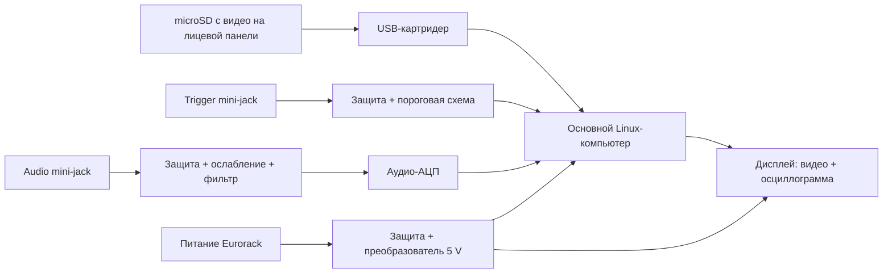

# Предварительная архитектура v2

## Цель пользователя

Скопировать обычные видео на microSD, вставить её в лицевую панель и
получить автоматическое воспроизведение без терминала на Mac. На каждый
триггер выбирать случайное видео и запускать с начала. Звук из видео не
нужен. Осциллограмма живого аудио появляется поверх видео при подключении
второго jack. Нужны внешний видеовыход HDMI и зарядка вейпа через USB-C.

По уточнению владельца, старый дисплей был примерно 2.8″ TFT 320×240.
Покупки планируются в РФ, преимущественно на Ozon. v1 обошлась примерно
в 6–7 тыс. руб.; бюджет v2 можно увеличить. Ширина не задана, но модуль
должен помещаться в Eurorack-кейс. Конкретная глубина кейса ещё неизвестна;
совместимость со всеми существующими кейсами гарантировать нельзя.

## Предлагаемый первый прототип

Raspberry Pi Zero 2 W — кандидат для прототипа с небольшим экраном.
Для окончательной компактной платы стоит сравнить его с Compute Module
на eMMC после измерений производительности, потребления и размеров.
Точную модель компьютера и дисплея пока выбирать рано.

Первым проверяется компактный SPI-дисплей 320×240 (например, на ILI9341)
и внешний HDMI. Полный RGB565-кадр при 30 fps требует минимум
`320 × 240 × 16 × 30 = 36.864 Мбит/с` полезного потока SPI без накладных
расходов. На заявленную частоту SPI нельзя опираться как на гарантию FPS:
важны драйвер, накладные расходы и способ получения кадров из видеоплеера.
Одновременные HDMI, локальный экран и наложение проверяются на плате.

Если этот вариант не даёт стабильных кадров, следующие кандидаты:
Compute Module с подходящим интерфейсом LCD или экран с HDMI-контроллером.
У Zero 2 W один HDMI-выход: для HDMI-LCD и внешнего HDMI одновременно
потребуется splitter для зеркального изображения либо другая архитектура.
Устройство с двумя независимыми видеовыходами нельзя обещать на этой плате.
Pi Zero использует mini-HDMI; micro-HDMI кабель от Pi 4/5 не подходит.

### Видеофайлы и съёмная карта

- ОС хранится отдельно от съёмной карты с клипами. На Zero 2 W это
  внутренняя microSD с ОС и отдельный USB-картридер для лицевой панели;
  у Compute Module можно выбрать eMMC для ОС.
- Первый гарантируемый формат нужно определить явно, например MP4 с
  H.264 8-bit. Расширение MOV/MP4 не определяет кодек. HEVC, AV1, HDR,
  переменная частота кадров и поворот из метаданных требуют отдельных проверок.
- При установке карты программа сканирует клипы, проверяет пригодность,
  подгоняет изображение под экран и запускает плейлист. На неподходящий
  файл должна быть понятная реакция без падения программы.
- Для H.264 планируется прямое воспроизведение. Для иных форматов можно
  рассмотреть автоматическую подготовку внутри модуля с индикацией ожидания;
  она не обязана происходить мгновенно и не должна переписывать оригиналы.
- Безопасное извлечение карты: чтение без записи, остановка воспроизведения
  при потере носителя и восстановление после повторной установки.
- Для короткой задержки по триггеру нужно заранее подготавливать следующий
  клип. Решение проверяется измерением «фронт триггера → первый новый кадр».

### Почему не начинать с Teensy

Teensy 4.1 подходит для обработки сигналов и небольших дисплеев. Обычные
сжатые видео потребуют программного декодирования или дополнительного
видеодекодера; стандартного аппаратного H.264-декодера на плате нет.
Небольшие специально подготовленные RAW/MJPEG-клипы возможны, но для
пользовательского сценария с обычными файлами Linux-компьютер проще.

### Осциллограмма и входы

- Pi Zero 2 W не имеет встроенного аналогового аудиовхода. Нужен внешний
  АЦП и аналоговый входной каскад; отдельный Arduino для рисования не нужен.
- Возможный компактный путь — I²S-АЦП класса PCM1808. До покупки нужны
  проверка генерации тактовых сигналов, Linux-драйвера, уровней и совместимости
  конкретной платы. Это ещё не готовая проверенная схема подключения.
- Для настольного прототипа подходит USB-аудиоинтерфейс с настоящим
  линейным входом; дешёвый микрофонный адаптер не равноценен.
- У Zero 2 W один USB-порт данных. Для USB-аудио одновременно с
  USB-картридером нужен hub; вариант I²S оставляет порт картридеру.
- Eurorack-аудио необходимо ослабить до диапазона выбранного АЦП и
  защитить вход. Для осциллограммы аудио обычно достаточно аудио-АЦП;
  отображение медленного/DC CV требует другой входной схемы.
- Триггерный вход получает защиту, порог и гистерезис. Напряжение Eurorack
  не подключается прямо к GPIO 3.3 V.
- Чтобы включать осциллограмму именно при вставленном кабеле, нужен jack
  с контактом обнаружения/подходящим переключающим контактом либо отдельное
  надёжное определение подключения. Проверка амплитуды аудио сама по себе
  не различает тишину и отсутствие кабеля.

### Питание

Преобразователь 12→5 V рассчитывается по измеренным пиковым нагрузкам
компьютера, дисплея, карты и периферии, с запасом на запуск. Нужны защита
от переполюсовки и проверка нагрева и помех на аудиовходе.

USB-зарядка должна быть отдельной защищённой ветвью с ограничением тока.
При питании от +12 V дополнительный ток приблизительно равен
`5 V × I_USB / (12 V × КПД)`. При КПД 85%: около 0.49 A для USB 1 A и
0.98 A для USB 2 A, сверх самого модуля. Эти значения — расчёт, не замеры.
USB-C подтверждён владельцем; согласование зарядки выбирается отдельно. Предлагаемый
первый режим — стандартные 5 V с ограничением 1 A, без обещания быстрой
зарядки. Вейп должен иметь собственный контроллер зарядки; зарядка голых
литиевых аккумуляторов этим USB-выходом не предусмотрена.
Для USB-C нужны корректные CC-сигналы источника и управление ограничением
тока. Нельзя рекламировать допустимый ток выше возможностей питания.

### Что обязательно проверить на настоящем прототипе

Воспроизведение репрезентативных файлов с нужными FPS; живое наложение
аудио; задержка триггера; серии быстрых триггеров; вставка/извлечение карты;
повторный запуск после отключения питания; пиковый ток, нагрев и шум.
Тест FFmpeg в облаке ни одну из этих аппаратных проверок не заменяет.

Ожидаемые ограничения: загрузка Linux занимает время; универсальная поддержка
любого видео не гарантируется; суммарная ширина определяется всей лицевой
панелью, а не только активной областью экрана (1 HP = 5.08 мм).

## Источники для дальнейшей сверки

- Raspberry Pi Zero 2 W: https://www.raspberrypi.com/products/raspberry-pi-zero-2-w/
- Compute Module: https://www.raspberrypi.com/products/compute-module-4/
- Документация Raspberry Pi: https://github.com/raspberrypi/documentation
- Teensy 4.1: https://www.pjrc.com/store/teensy41.html
- PCM1808: https://www.ti.com/product/PCM1808

Ссылки указаны как первичные источники для сверки; точные сочетания платы,
драйверов и дисплея ещё не испытаны.
